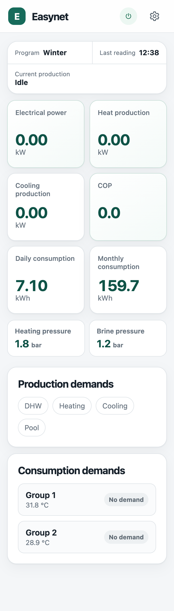
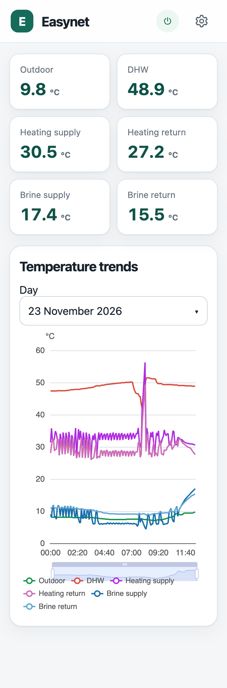
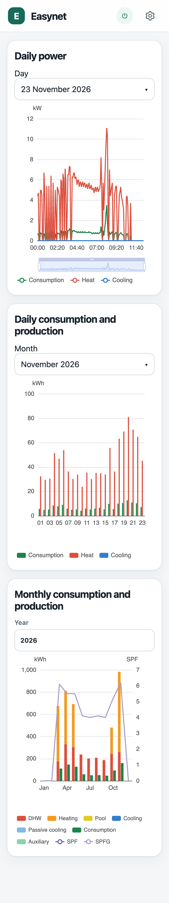

# Easynet Web

A modern, local, read-only web interface for monitoring an Ecoforest heat pump
through EasyNet.

Use it to:

- view current power, COP, temperatures, pressures, demands, and alarms;
- keep history beyond EasyNet's short retention period;
- view daily, monthly, and annual energy charts;
- use the interface from a phone with a responsive PWA;
- choose among seven languages and Celsius/Fahrenheit.

## Screenshots

<table>
  <tr>
    <td align="center" width="33%">
      
      <br>
      <strong>Current status</strong>
    </td>
    <td align="center" width="33%">
      
      <br>
      <strong>Temperatures and pressures</strong>
    </td>
    <td align="center" width="33%">
      
      <br>
      <strong>Energy history</strong>
    </td>
  </tr>
</table>

> **Enjoying the project? Buy me a coffee!**
> You can support its development with a voluntary donation on Ko-fi.

[](https://ko-fi.com/mcalve)

## Read-only and local

This release does not change any EasyNet setting. It reads the pump, stores
history in SQLite, and serves a dashboard to the trusted local network.

Do not expose EasyNet itself to the Internet.

## Requirements

- An Ecoforest heat pump with a working EasyNet web interface.
- A Linux machine that can reach EasyNet on the local network.
- A Raspberry Pi 4 or equivalent is recommended.
- Python 3.12 or later.
- Node.js 22 LTS or later.
- Caddy and `systemd`.
- Basic terminal/SSH access.

The reference deployment uses:

```text
Code:          /opt/easynet-web
Configuration: /etc/easynet-web.env
Database:      /var/lib/easynet-web/easynet.db
Backups:       /var/lib/easynet-web/backups
```

## Quick install on Raspberry Pi/Linux

The following steps use the reference paths above. Replace placeholders with
your own values.

### 1. Create the service account and directories

```bash
sudo useradd --system --home /var/lib/easynet-web --shell /usr/sbin/nologin easynet
sudo install -d -o easynet -g easynet -m 755 /opt/easynet-web
sudo install -d -o easynet -g easynet -m 750 \
  /var/lib/easynet-web /var/lib/easynet-web/backups /var/log/easynet-web
```

### 2. Copy the project

Clone or copy the repository to `/opt/easynet-web`:

```bash
sudo git clone https://github.com/mcalvete/easynet-web.git /opt/easynet-web
sudo chown -R easynet:easynet /opt/easynet-web
sudo chmod 755 /opt/easynet-web
```

Do not copy local `.env`, `.venv`, database, logs, or `node_modules` files.

### 3. Install backend and build frontend

```bash
sudo -u easynet python3 -m venv /opt/easynet-web/.venv
sudo -u easynet /opt/easynet-web/.venv/bin/pip install \
  -e /opt/easynet-web -c /opt/easynet-web/constraints.txt

sudo -u easynet bash -c \
  'cd /opt/easynet-web/frontend && npm ci && npm run build'
```

### 4. Configure EasyNet

Create the production configuration:

```bash
sudo install -m 600 -o easynet -g easynet \
  /opt/easynet-web/.env.example /etc/easynet-web.env
sudo editor /etc/easynet-web.env
```

Set at least these values:

```dotenv
EASYNET_HOST=https://YOUR_EASYNET_IP
EASYNET_HTTPS_ADDRESS=YOUR_RASPBERRY_IP
DATABASE_PATH=/var/lib/easynet-web/easynet.db
API_HOST=127.0.0.1
API_PORT=8000
```

- `EASYNET_HOST`: the EasyNet IP or hostname.
- `EASYNET_HTTPS_ADDRESS`: the Raspberry Pi/private IP that clients will open.

Most EasyNet installations accept unauthenticated local reads. If yours
requires authentication, also configure `EASYNET_USERNAME` and
`EASYNET_PASSWORD`.

EasyNet commonly uses a self-signed certificate. Keep:

```dotenv
EASYNET_VERIFY_TLS=false
```

### 5. Install the API service and backup timer

```bash
sudo install -m 644 \
  /opt/easynet-web/deploy/systemd/easynet-web.service \
  /etc/systemd/system/easynet-web.service
sudo install -m 644 \
  /opt/easynet-web/deploy/systemd/easynet-backup.service \
  /etc/systemd/system/easynet-backup.service
sudo install -m 644 \
  /opt/easynet-web/deploy/systemd/easynet-backup.timer \
  /etc/systemd/system/easynet-backup.timer
sudo install -m 755 -o root -g root \
  /opt/easynet-web/deploy/backup-easynet.sh \
  /usr/local/libexec/easynet-backup

sudo systemctl daemon-reload
sudo systemctl enable --now easynet-web
sudo systemctl enable --now easynet-backup.timer
```

### 6. Install Caddy

For final HTTPS access by private IP:

```bash
sudo install -d -m 755 /etc/systemd/system/caddy.service.d
sudo install -m 644 \
  /opt/easynet-web/deploy/systemd/caddy-easynet.conf \
  /etc/systemd/system/caddy.service.d/easynet.conf
sudo install -m 644 /opt/easynet-web/deploy/Caddyfile /etc/caddy/Caddyfile

sudo systemctl daemon-reload
sudo env EASYNET_HTTPS_ADDRESS=YOUR_RASPBERRY_IP \
  caddy validate --config /etc/caddy/Caddyfile
sudo systemctl restart caddy
```

Alternatively, for temporary HTTP setup on port 8080:

```bash
sudo install -m 644 /opt/easynet-web/deploy/Caddyfile.http /etc/caddy/Caddyfile
sudo systemctl restart caddy
```

HTTPS is recommended. HTTP is useful only during initial setup on a trusted
network.

## Open the application

- HTTPS: `https://YOUR_RASPBERRY_IP`
- Temporary HTTP: `http://YOUR_RASPBERRY_IP:8080`

If the browser warns about the HTTPS certificate, install Caddy's local root CA
on that client:

```text
/var/lib/caddy/.local/share/caddy/pki/authorities/local/root.crt
```

- macOS: import `root.crt` into Keychain Access and trust it for SSL.
- iPhone/iPad: install the profile, then enable full trust in
  `Settings > General > About > Certificate Trust Settings`.

This lets the browser use HTTPS by private IP and install the app as a PWA.

## Verify the installation

```bash
sudo systemctl status easynet-web
sudo systemctl status caddy
sudo systemctl status easynet-backup.timer
curl --fail http://127.0.0.1:8000/api/health
journalctl -u easynet-web -n 100 --no-pager
```

For HTTPS verification with Caddy's local CA:

```bash
sudo curl \
  --cacert /var/lib/caddy/.local/share/caddy/pki/authorities/local/root.crt \
  --fail https://YOUR_RASPBERRY_IP/api/health
```

## Features

- Current status, demands, power, COP, pressures, temperatures, and alarms.
- Separate Temperature tab with current sensors and historical charts.
- Daily consumption/production, monthly charts, and annual summaries.
- Long-term history beyond EasyNet's approximately three-month retention.
- Data-quality handling for gaps and daylight-saving transitions.
- English, Spanish, German, French, Italian, Dutch, and Polish.
- Celsius/Fahrenheit.
- Responsive mobile/desktop interface and PWA.
- Daily consistent SQLite backups.

## Backups

The timer stores local backups in `/var/lib/easynet-web/backups` and retains 14
days.

Create one manually:

```bash
sudo systemctl start easynet-backup.service
```

Do not copy the active database directly. Any encrypted or off-site transfer
procedure is intentionally kept outside this public repository.

## HTTPS by local hostname

If your network provides local DNS, set `EASYNET_HTTPS_ADDRESS` to that hostname
instead of the Raspberry IP, then use the same Caddyfile.

Names ending in `.local` use mDNS and often do not resolve through a routed VPN.
For cross-network access, prefer ordinary local DNS or the private IP.

## Troubleshooting

### No data appears

- Check `journalctl -u easynet-web`.
- Verify that `EASYNET_HOST` opens from the Raspberry.
- Recheck optional EasyNet credentials.
- Confirm EasyNet has not changed its protocol after a firmware update.

### HTTPS certificate warning

- Confirm the Caddy root CA is trusted on that device.
- Confirm `EASYNET_HTTPS_ADDRESS` matches the URL used in the browser.
- Do not accept an unrelated certificate.

### The page works on HTTP but not HTTPS

- Check `systemctl status caddy`.
- Run `caddy validate --config /etc/caddy/Caddyfile`.
- Check that ports 80 and 443 are reachable on the trusted LAN.

## Project structure and technical notes

```text
backend/     FastAPI, EasyNet protocol, collector, importer, SQLite
frontend/    React/TypeScript PWA and charts
deploy/      systemd units, Caddy files, backup script
fixtures/    sanitized test data
```

For the complete generic deployment reference, see
[deploy/README.md](deploy/README.md).

## Development

Backend checks:

```bash
python3 -m venv .venv
.venv/bin/pip install -e . pytest pytest-asyncio ruff -c constraints.txt
.venv/bin/pytest
.venv/bin/ruff check backend
```

Frontend checks:

```bash
cd frontend
npm ci
npm test
npm run build
```

## Compatibility

The protocol has been verified with one Ecoforest ecoGEO installation running
EasyNet 2024 firmware. Other models and firmware versions may expose different
blocks or units. Unsupported responses are reported rather than silently
converted to valid-looking values.

## Safety and disclaimer

This is an unofficial, read-only project. It is not affiliated with or
supported by Ecoforest. Use at your own risk and consult your installer for
machine alarms or unexpected operation.

Ecoforest and ecoGEO are trademarks of their respective owners.

## License

Released under the [MIT License](LICENSE).

## Acknowledgements and support

Protocol research was informed by the
[Ecoforest integration for Home Assistant by bytestorm](https://github.com/bytestorm/ecoforest_ecogeo)
and [homebridge-ecoforest-ecogeo](https://github.com/mcalvete/homebridge-ecoforest-ecogeo).

**Keeping your home comfortable? Buy me a coffee!**

Donations are optional and appreciated:

[](https://ko-fi.com/mcalve)
